# Event Registration and Check-In System

A console-based Java application that handles event participant registration and a first-in, first-out (FIFO) check-in line. It uses hand-written sorting algorithms and parallel ArrayLists, and is built procedurally with no custom classes.

**Contents:** [Overview](#overview) · [Goals](#goals) · [Menu and Features](#menu-and-features) · [Data Structures](#data-structures) · [Sorting Algorithms](#sorting-algorithms) · [Running the Program](#running-the-program) · [Screenshots](#screenshots)

---

## Overview

At events, attendees often arrive all at once and must be checked in fairly, in the order they reached the desk. This program keeps a record for every registered participant (registration number, name, registration date, and status) and lets staff line participants up in a check-in queue. Whoever joined the line first is checked in first. Staff can also search the records and sort them by name, registration number, or registration date to make them easier to review. Sorting only rearranges the stored records. It never changes who is next in line.

## Goals

- Write sorting algorithms by hand instead of using Java's built-in sort methods.
- Use a Java `Queue` for enqueue, dequeue, peek, display, and empty-check operations that follow FIFO order.
- Keep participant data in ArrayLists whose indexes always stay aligned.
- Practice methods, loops, conditionals, and input validation in a procedural style.
- Bring records, search, sorting, and the queue together in a single menu-driven program.

## Menu and Features

| Option | Feature | What it does |
|:------:|---------|--------------|
| 1 | Register a participant | Saves a name and a registration date (`yyyy-MM-dd`, or press Enter for today). A unique registration number is generated automatically, starting at 1001. |
| 2 | Display all participants | Prints every record in a table with its current status. |
| 3 | Search for a participant | Looks up a participant by exact registration number or by name. Name searches accept partial text and ignore letter case. |
| 4 | Sort records | Lets the user pick the field (name, registration number, or date), the order (ascending or descending), and the algorithm (Bubble, Insertion, or Selection Sort). The records are shown before and after. |
| 5 | Enqueue | Adds a registered participant to the back of the check-in line using their registration number. |
| 6 | Dequeue | Takes the participant at the front of the line, checks them in, and shows how many are still waiting. |
| 7 | Peek | Shows who is next without removing them from the line. |
| 8 | Display waiting list | Lists the queue from front to back with each participant's position. |
| 9 | Check if queue is empty | Reports whether anyone is still waiting. |
| 0 | Exit | Closes the program. |

Each participant has one of three statuses: **Registered**, **In Queue**, or **Checked In**. Dequeuing a participant updates their status automatically.

**Validation and messages.** The program handles invalid menu choices, non-numeric input, blank names, impossible or badly formatted dates, unknown registration numbers, empty record lists, and empty queues without crashing. It also stops a participant from being queued twice, and from being queued again once they have checked in.

## Data Structures

**ArrayLists (record storage).** Each participant is stored across four parallel ArrayLists. The value at index `i` in every list belongs to the same person.

| ArrayList | Type | Holds |
|-----------|------|-------|
| `regNumbers` | `Integer` | Registration number |
| `names` | `String` | Participant name |
| `regDates` | `String` | Registration date (`yyyy-MM-dd`) |
| `statuses` | `String` | Registered / In Queue / Checked In |

All sorting algorithms rearrange the records through one shared `swapRecords(i, j)` method that swaps the entries in all four lists at once, so a participant's details can never drift apart.

**Queue (check-in order).** The waiting line is a `Queue<Integer>` backed by a `LinkedList`. It stores registration numbers rather than copies of records or list positions. When the program needs to show or process someone, it looks up their registration number in the ArrayLists with `findIndexByRegNo`. Because the queue holds registration numbers, sorting the ArrayLists cannot disturb the line. Every dequeue, peek, and display checks for an empty queue first.

**Procedural design.** The program consists of the `main` method, static methods, static fields, and built-in Java classes such as `Scanner`, `ArrayList`, `Queue`, and `LocalDate`. No custom entity classes are defined.

## Sorting Algorithms

All three algorithms are implemented manually in `Main.java`, and none rely on built-in sorting methods. A shared `compareRecords` method handles the chosen field and order. Names are compared as text without regard to letter case, registration numbers as numbers, and dates as `yyyy-MM-dd` text, which orders correctly by calendar date.

| | Bubble Sort | Insertion Sort | Selection Sort |
|---|---|---|---|
| **How it works** | Compares neighboring records and swaps them when out of order, repeating passes until nothing needs swapping | Builds a sorted section from the left, moving each new record backward until it sits in the right place | Finds the smallest remaining record on each pass and places it at the front of the unsorted part |
| **Why it suits this program** | Easy to follow and stops early once the list is already in order | Works well on small or nearly sorted lists, such as participants who registered in order | Makes the fewest swaps, and its steady behavior is easy to demonstrate |
| **Best case** | O(n) with early exit | O(n) | O(n²) |
| **Average / worst case** | O(n²) | O(n²) | O(n²) |
| **Stable** | Yes | Yes | No |

Participants with equal values, such as the same registration date, keep their relative order under Bubble and Insertion Sort. Sorting changes the order of the records only, so the check-in queue remains in arrival order.

## Running the Program

**Requirements:** Java Development Kit (JDK) 8 or later.

From the folder containing `Main.java`:

```
javac Main.java
java Main
```

**Suggested first run:** register several participants (option 1), try a search (option 3) and a sort (option 4), enqueue a few participants (option 5), then use peek, display, and dequeue (options 7, 8, 6) to watch FIFO order in action. Enter `0` to exit.

## Screenshots

### 1. Main Menu
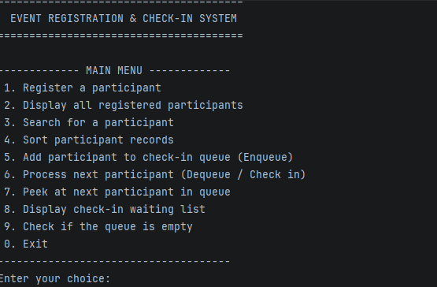

*The main menu listing every available operation.*

### 2. Registering and Displaying Participants
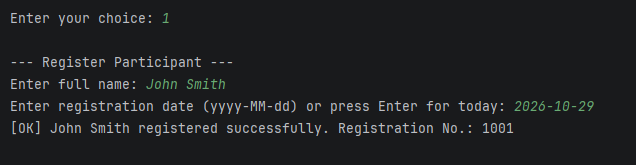

*A participant is registered with a name and a date, and the system assigns registration number 1001.*

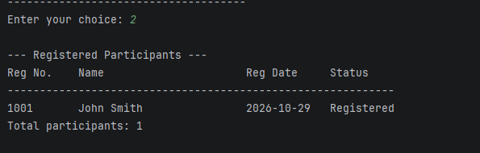

*The stored record shown with its registration number, date, and status.*

### 3. Searching
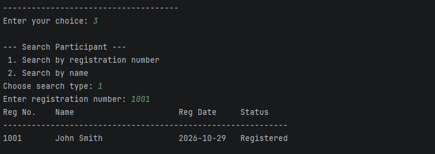

*Searching by registration number returns the matching record.*

### 4. Queue Operations


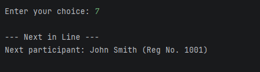

*Peek shows the next participant, John Smith, without removing him from the line.*


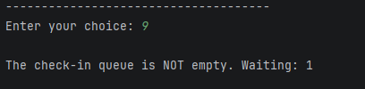

*The empty check reports that the queue still has a participant waiting.*

### 5. Bubble Sort
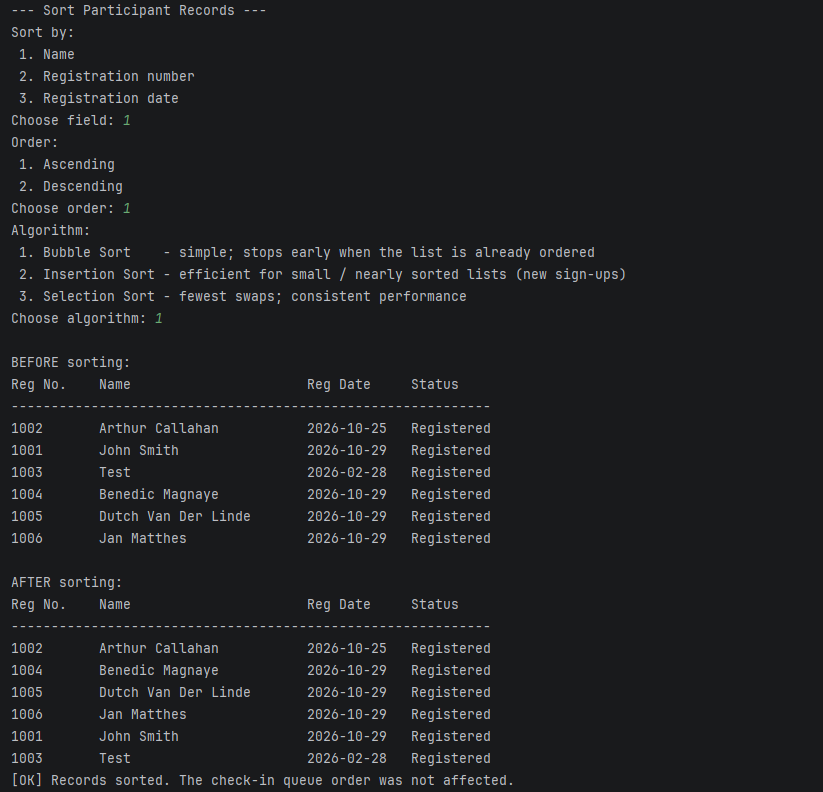

*Records before and after Bubble Sort by name, ascending.*

### 6. Insertion Sort
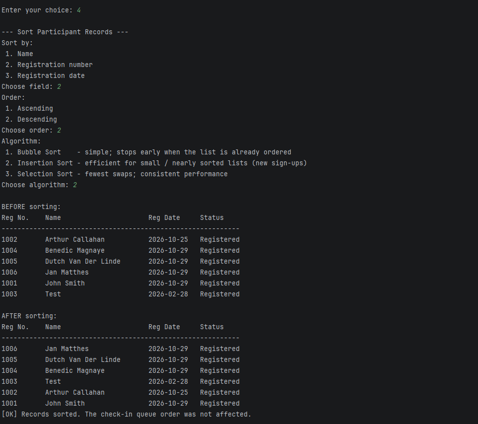

*Records before and after Insertion Sort by registration number, descending.*

### 7. Selection Sort
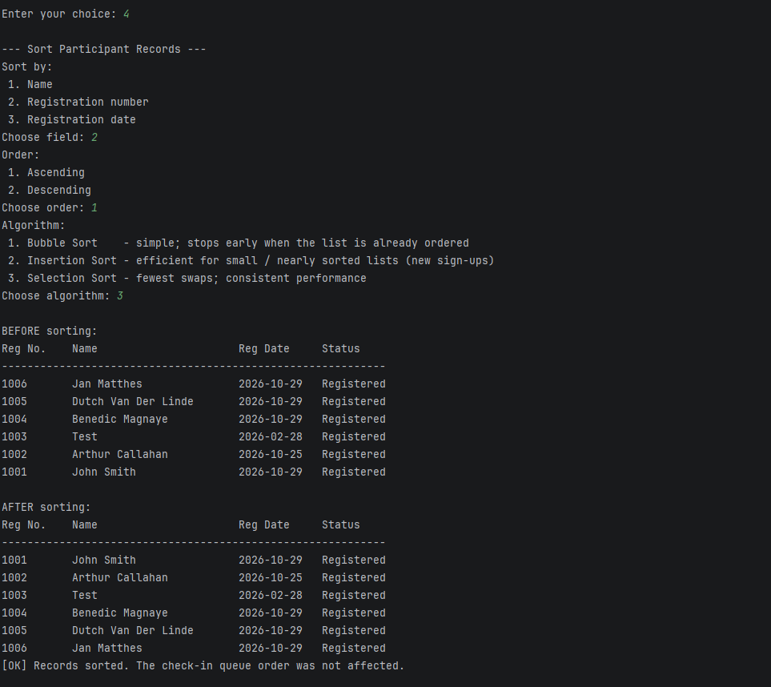

*Records before and after Selection Sort by registration number, ascending.*

### 8. Input Validation
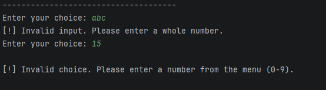

*Non-numeric input and an out-of-range menu choice are rejected and the user is prompted again.*

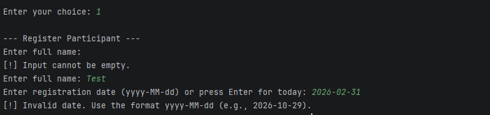

*A blank name and an impossible date (2026-02-31) are rejected.*
